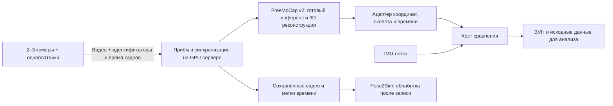

# Сравнение визуального и IMU-захвата движений

Дата проверки: **2026-10-28**.

Этот каталог содержит исследование решений и план интеграции с ImuMotionCapture.
Реализованный RTSP-сервер с RTMPose, WebGL и сетевым BVH описан в
[server/README.md](server/README.md); приложение — [visual_mocap_server.py](server/visual_mocap_server.py).
Отправка видео с Ubuntu/Debian на этот сервер —
[camera_streamer.py](camera/camera_streamer.py), инструкция [camera/README.md](camera/README.md).
Ниже сохранено сравнение готовых пакетов, на котором основан выбор компонентов.
Выводы основаны на локальном коде, документации разработчиков и публикациях;
производительность на целевом GPU-сервере ещё не измерялась.

## Задача

- Две или три RGB-камеры подключены к отдельным одноплатным компьютерам.
- Видео передаётся по локальной сети на сервер с GPU.
- Сервер вычисляет движение и передаёт результат хосту сравнения с IMU.
- Нужны работа в реальном времени и возможность сохранения BVH.
- Предпочтительны публикации о системе в журналах JCR/Web of Science Q1–Q2.
- Нужны готовый код инференса и предобученные веса, без обучения модели с нуля.

Модели камер, одноплатников, GPU, ОС сервера и текущий протокол видеопередачи
пока не определены. Поддержка CUDA ниже относится к серверу с NVIDIA GPU.
Характеристики локального компьютера из аудита не описывают удалённый сервер.

## Рекомендация

**Основной кандидат для live-прототипа — FreeMoCap 2.x с предобученным
RTMPose/RTMW.** Он уже объединяет детекцию, многокамерную триангуляцию,
фильтрацию и поток результатов. Разрабатывать придётся приём сетевых камер,
проверку синхронизации и адаптер к нашему хосту, а не обучать распознавание
движения. Возможности v2 описаны в [архитектуре обработки][fm-pipeline]
и [WebSocket API][fm-ws].

Это выбор для проверки прототипа, а не утверждение о готовности всей установки.
Прямой приём произвольных RTSP-потоков с корректным временем съёмки не подтверждён.
v2 находится в alpha; опубликованный выпуск и ветка `main` могут отличаться.
Для воспроизводимого эксперимента необходимо закрепить фактически проверенные
версию, commit, модель, веса, калибровку и параметры фильтрации.
Публикацию JCR Q1/Q2, валидирующую именно эту полную live-конфигурацию v2,
в ходе исследования не подтвердили.

**Pose2Sim рекомендуется как дополнительный научный baseline для обработки
сохранённых видео.** У него есть статьи в Sensors и готовый инференс с RTMPose.
Однако покадровая обработка всей 3D-цепочки в реальном времени ещё указана
в планах проекта. Поэтому Pose2Sim нельзя считать готовой заменой live-сервера.
В исходных статьях использовались OpenPose и OpenSim: их численные результаты
не являются валидацией современной конфигурации RTMPose с нашими камерами.
[Код и ограничения Pose2Sim][pose2sim], [публикации](SOURCES.md#pose2sim).

Если статья Q1/Q2 обязательна именно для выбранного пакета, а отложенная
обработка допустима, приоритет следует отдать Pose2Sim. Если одновременно
обязательны live, произвольные сетевые RGB-камеры и готовый BVH-поток,
полностью соответствующее готовое решение пока не подтверждено.

## Готовность кандидатов

Квартиль относится к журналу и конкретному году рейтинга. Подробные статьи,
источники JCR за 2024 год и ограничения переноса результатов приведены
в [SOURCES.md](SOURCES.md). Квартиль не является оценкой точности ПО.

| Решение | Готовый инференс без обучения | Пригодность для наших камер | Выход и оставшаяся интеграция | Научное основание |
|---|---|---|---|---|
| [FreeMoCap 2.x][fm-pipeline] | Да, предобученные детекторы | Live-многокамерный тракт; сетевой ввод требует проверки/адаптера | WebSocket; BVH через обработку и Blender; мост к хосту | Валидация полной выбранной v2-конфигурации в Q1/Q2 не подтверждена |
| [Pose2Sim][pose2sim] | Да, RTMPose встроен | Калиброванные RGB-видео; полный live-тракт ещё в roadmap | 3D-траектории и OpenSim-кинематика; для BVH нужен отдельный путь преобразования | Sensors, 2021/2022; JCR 2024 Q2 |
| [OpenPose][openpose] | Да, опубликованы веса и код | Есть 3D-модуль для нескольких синхронизированных камер; свой ввод возможен | Точки → обратная кинематика → вращения → отправитель | TPAMI, 2021; JCR 2024 Q1 |
| [Hi-ROS][hiros] | Готово объединение скелетов; детектор нужен отдельно | Принимает уже вычисленные 3D-позы; не готовая RGB-триангуляция | ROS-сообщения; нужен адаптер позы/BVH | CVIU, 2023; JCR 2024 Q2 |
| [XNect][xnect] | Да, C++-библиотека и модель доступны через регистрацию | Одна RGB-камера; отдельный монокамерный baseline | Углы суставов; готовый сетевой BVH-интерфейс не подтверждён | ACM TOG, 2020; JCR 2024 Q1 |
| [MocapNET][mocapnet] | Да, предобученные модели | Одна RGB-камера; штатное объединение нескольких видов не подтверждено | BVH-позы, файл, ROS-интеграция; адаптация к протоколу хоста | Оригинальные работы конференционные; оценка RTMPose + v2 в PLOS ONE, 2026, JCR 2024 Q2 |
| [MocapForAll][mocapforall] | Готовое приложение | Две и более камеры; совместимость сетевого видеоввода надо проверять | Live VMC/VMT, BVH-файл; нужен приёмник соответствующего протокола | Подходящая статья Q1/Q2 не подтверждена |
| [CapturyLive][captury] | Готовая коммерческая система | Производитель описывает от четырёх GigE-камер; наши источники не подтверждены | Live SDK/ROS/OSC; BVH-экспорт отдельно | В Sensors есть проверка CapturyStudio; она не валидирует Live-конфигурацию |

OpenPose подходит как исследовательская точка отсчёта, но его 3D-модуль
официально не поддерживается активно. Он потребует больше работы с источниками,
кинематикой и выходом, чем прототип на готовом FreeMoCap v2.
Hi-ROS проверяли с RGB-D/Azure Kinect; это ограничивает перенос результатов
на обычные RGB-камеры. MocapNET и XNect полезны для отдельного сравнения
монокамерного метода, но не заменяют многокамерную геометрическую реконструкцию.

## Что уже готово, а что нужно написать

Обучение нейросети, калибровка камер и подгонка скелета — разные операции.
Для предложенных стандартных моделей обучение на наших записях не требуется.
Калибровка камер, установка масштаба, согласование систем координат и проверка
длины сегментов всё равно необходимы.

| Компонент | Что использовать |
|---|---|
| Детекция человека и 2D-точек | Готовые веса RTMPose/RTMW и инференс FreeMoCap/SkellyTracker |
| Триангуляция и live-фильтрация | Существующий тракт FreeMoCap v2 |
| Ввод видео с одноплатников | Проверить существующий протокол; добавить приём и привязку времени кадров |
| Поток к нашему хосту | Адаптер WebSocket → согласованный формат позы |
| Скелетные вращения | Проверить доступность и определения в выбранной версии; при выходе только XYZ нужен кинематический адаптер |
| BVH | Переиспользовать наш экспортёр с учётом ограничений ниже |
| Контрольная обработка записей | Pose2Sim с зафиксированными настройками |

Если для сетевых источников понадобится собственный inference-сервис,
[rtmlib][rtmlib] уже предоставляет Python API, модели и пример обработки
камеры/видео. Это запасной вариант с готовым распознаванием, но сам по себе
rtmlib не выполняет всю многокамерную реконструкцию и не выдаёт BVH.
Не следует устанавливать зависимости новых решений в старый `freemocap-env`:
каждому исполняемому сервису требуется отдельное окружение.

## Предлагаемый тракт

Это проектируемая схема, не описание уже работающей интеграции.

### Два способа подключить сетевые камеры

1. **Быстрая проверка:** декодировать каждый сетевой поток в отдельное виртуальное
   V4L2-устройство на Linux. FreeMoCap v2 имеет настройку поиска виртуальных
   камер. Этот вариант проверяет совместимость и пропускную способность,
   но не доказывает точность временного совмещения.
   [Настройка камер][fm-cameras], [v4l2loopback][v4l2loopback].
2. **Измерительный стенд:** сохранять исходные метки времени и явно формировать
   согласованные наборы кадров перед реконструкцией. Для этого может понадобиться
   адаптер источника в SkellyCam/FreeMoCap. Возможность передать исходное время
   через все стадии необходимо проверить по закреплённой версии кода.

Часы одноплатников и сервера должны иметь известное взаимное смещение.
`monotonic`-время разных машин нельзя непосредственно сравнивать.
Синхронизация часов сама по себе не синхронизирует экспозиции камер;
важно понимать происхождение метки времени в драйвере и измерять остаточную
рассинхронизацию. Время прихода пакета на сервер не заменяет время съёмки.
Одинаковые FPS и одновременный запуск процессов также не гарантируют совпадения кадров.

Для первичной проверки стоит снять общий световой импульс, затем проверить
сдвиг в начале и конце записи. Видео, номера кадров, пропуски и исходные
временные метки нужно сохранять для повторной обработки.

### Контракт данных для хоста

Предлагаемые поля будущего адаптера; это не существующий API:

- `source_id`, `frame_id`, `schema_version` и версия калибровки;
- `capture_timestamp`, `clock_id`, `receive_timestamp`, `inference_done_timestamp`;
- номера и исходное время кадров каждой камеры, использованных для одной позы;
- имена 3D-точек, координаты в метрах и признаки достоверности;
- положение корня и мировые вращения сегментов, если они доступны;
- определения осей, нейтральной позы, локальных базисов костей и порядка кватерниона.

BVH является форматом записи скелетной анимации. Передача позы по сети требует
согласованного транспорта и схемы сообщений. Возможность сохранить `.bvh`
не означает совместимости с любым внешним «BVH-stream» приёмником.

## Ограничения существующего хоста

Проверены [BVH-экспортёр](../../host/storage/bvh.py),
[его описание](../../host/storage/README.md) и
[адаптер визуализатора](../../host/viz/pyqt_mocap/window_recording.py).

- `BvhRecording.append(timestamp, orientations)` принимает мировые матрицы
  вращения. Координаты суставов нельзя передать вместо них.
- Текущий `BvhRecording.append` поддерживает покадровый `root_position`.
  Визуальный сервер использует его для передачи перемещения таза;
  без этого аргумента сохраняется положение, заданное при создании записи.
- Вход экспортёра: метры, X вправо, Y вперёд, Z вверх. Выход: Y вверх,
  вращения ZXY; базовый класс по умолчанию пишет сантиметры, адаптер GUI — метры.
- GUI нормирует аватар до 1,70 м. Для метрического сравнения нельзя незаметно
  применять эту нормировку только к одной системе.
- Текущий IMU-адаптер использует корпус, два плеча и два предплечья. Кисти
  наследуют вращение предплечий; ноги не имеют собственных измеренных вращений.
  Эти сегменты нельзя считать измеренными IMU при сравнении с full-body vision.
- При сохранении BVH нерегулярный поток пересэмплируется удержанием последней
  позы. Для метрик задержки и пропусков нужно сохранять также исходный поток.

Для первого сравнения достаточно общих измеряемых сегментов верхней части тела.
Направление кости по двум точкам не определяет вращение вокруг её оси;
пронацию/супинацию нельзя объявлять измеренной без дополнительных ориентиров
или явно указанной модели. Согласование базисов IMU и визуального скелета
необходимо выполнять до расчёта угловых ошибок.

## Порядок реализации и проверки

1. Уточнить GPU/ОС сервера, камеры, видеопротокол, источник временных меток
   и существующий интерфейс хоста; выбрать закреплённую версию FreeMoCap v2.
2. На готовой модели обработать тестовые видео. Проверить фактическое
   выполнение инференса на GPU, схему результата и воспроизводимость запуска.
3. Подключить два сетевых видеопотока; откалибровать камеры и проверить
   синхронизацию. Третью камеру добавить для оценки уменьшения окклюзий.
4. Получить live-результат через API и сопоставить точки/сегменты хоста.
   Если доступны только точки, отдельно проверить восстановление вращений.
5. Записать визуальный и IMU-потоки на общей временной шкале. Протокол
   согласования времени должен охватывать и IMU-устройство.
6. Измерить FPS, p50/p95 задержки, рассинхронизацию камер, пропуски,
   reprojection error и ошибки общих сегментов. Обе системы считать
   измерителями, а не автоматически назначать IMU абсолютной истиной.
7. Повторно обработать сохранённые видео Pose2Sim. Раздельно представить
   результаты live-фильтрации и обработки с доступом к будущим кадрам.

Численные требования к частоте, задержке и точности следует задать до
эксперимента. Опубликованный FPS детектора не гарантирует такую же частоту
полного тракта с декодированием, синхронизацией, 3D-реконструкцией и передачей.

## Материалы

- [Публикации, JCR и документация](SOURCES.md).
- [Аудит локального freemocap-env](FREEMOCAP_ENV.md).

[fm-pipeline]: https://github.com/freemocap/freemocap/blob/main/freemocap-docs/docs/architecture/backend-mocap.mdx
[fm-ws]: https://docs.freemocap.org/reference/websocket-api/
[fm-cameras]: https://docs.freemocap.org/guides/camera-setup/
[pose2sim]: https://github.com/perfanalytics/pose2sim
[openpose]: https://github.com/CMU-Perceptual-Computing-Lab/openpose/blob/master/doc/advanced/3d_reconstruction_module.md
[hiros]: https://github.com/HiROS-unipd
[xnect]: https://vcai.mpi-inf.mpg.de/projects/XNect/
[mocapnet]: https://github.com/FORTH-ModelBasedTracker/MocapNET
[mocapforall]: https://akiya-research-institute.github.io/MocapForAll-Manual/en/
[captury]: https://captury.com/real-time-processing/
[rtmlib]: https://github.com/Tau-J/rtmlib
[v4l2loopback]: https://github.com/v4l2loopback/v4l2loopback
